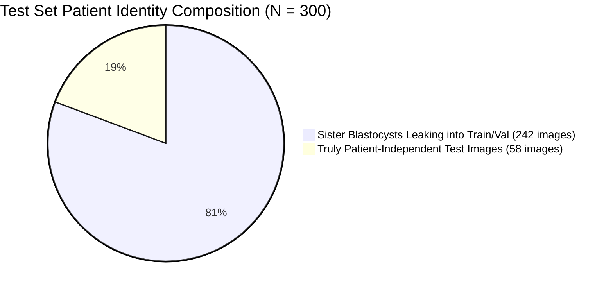
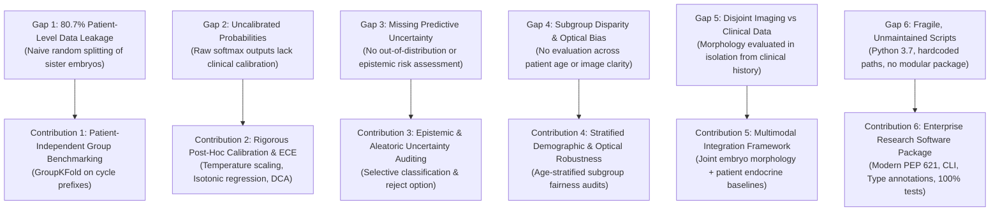

# FertiScope — Independent Repository Establishment & Research Gap Audit

**Date of Audit:** November 1, 2026  
**Auditor / Lead Investigator:** FertiScope Research Engineering  
**Target Project:** FertiScope (Independent Research Software Project)  
**External Benchmark Reference:** [Blastocyst-Dataset (SCCH / Nature Scientific Data)](https://github.com/software-competence-center-hagenberg/Blastocyst-Dataset)  
**Primary Dataset Reference:** [Figshare DOI: 10.6084/m9.figshare.20123153.v3](https://doi.org/10.6084/m9.figshare.20123153.v3)  
**Associated Primary Publication:** Florian Kromp et al., *"An annotated human blastocyst dataset to benchmark deep learning architectures for in vitro fertilization"*, *Scientific Data* 10, Article 271 (2023), [DOI: 10.1038/s41597-023-02182-3](https://doi.org/10.1038/s41597-023-02182-3).  
**Inspection Mode:** **Read-Only / Clean-Room Reference Inspection (Stage 1 — No code imported, no models trained, no repository modified).**

---

## 1. Existing FertiScope Workspace Status

The existing FertiScope workspace is located at:
```text
C:\Users\vaish\.gemini\antigravity\scratch\fertiscope
```

### 1.1 Architecture & Components
- **Package Root:** `src/fertiscope` (modern `pyproject.toml` layout with setuptools PEP 621 compliance).
- **Core Modules:**
  - `fertiscope.core.exceptions`: Domain-specific exceptions (`FertiScopeError`, `DatasetNotFoundError`, `IntegrityVerificationError`).
  - `fertiscope.core.logging`: Standardized research logging pipeline.
  - `fertiscope.data.provenance`: Cryptographic hashing (SHA-256) and immutable provenance records (`DatasetProvenanceRecord`).
  - `fertiscope.data.audit`: Raw data forensic auditor (`RawDataAuditor`).
  - `fertiscope.data.schema`: Pydantic clinical validation models (`PatientRecordSchema`).
- **Data Boundary:** Strict `.gitignore` rules prevent raw clinical datasets, Excel workbooks, and CSVs from entering version control.
- **Test Suite:** `tests/test_data_foundation.py` containing **8/8 passing unit tests** covering provenance, SHA-256 calculation, missing file detection, schema validation, cohort arithmetic, sperm unit split, and repeated profile detection.
- **Git State:** Local Git repository initialized on branch `master` with no commits yet. Phase 1 foundation files and the previous candidate audit report (`docs/PHASE_1_DATA_FOUNDATION_AUDIT.md`) are present.
- **Integrity Rule:** All existing Phase 1 architecture, schemas, and tests are strictly preserved without modification.

---

## 2. Original Reference Repository Structure & Functionality

The external benchmark repository [`software-competence-center-hagenberg/Blastocyst-Dataset`](https://github.com/software-competence-center-hagenberg/Blastocyst-Dataset) was cloned and inspected in an isolated reference directory (`C:\Users\vaish\AppData\Local\Temp\ref_blastocyst\repo`).

### 2.1 File Inventory & Directory Layout
```text
Blastocyst-Dataset/
├── README.md                              # Brief repo overview, environment notes (Python 3.7)
├── complete.csv                           # Silver-standard annotations for all 2,344 blastocysts
├── create_testset.py                      # Random sampling script for the 300-image test set
├── combine_testset_annotations.py         # Majority voting across international annotators
├── testset_statistics_annotators.py       # Mean/std accuracy of annotators vs consensus vote
├── calculate_model_metrics.py             # Accuracy, precision, recall, and weighted F1-score
├── calculate_inter_annotator_agreement.py # Cohen's Kappa inter-annotator agreement
├── convert_model_predictions.py           # Argmax conversion of probability files into labels
├── annotations/                           # Expert annotator raw votes
│   ├── Annotator_0.csv ... Annotator_10.csv (11 individual expert files)
│   ├── Gardner_Expert.csv                # Primary reference embryologist votes (N = 300)
│   └── test_rev.csv                      # Gold-standard consensus annotations (N = 300)
└── model_predictions/                     # Predictions across 12 deep learning architectures
    ├── coatnet_nano/                      # (exp.csv, icm.csv, teq.csv, pred.csv)
    ├── convnextv2_nano/
    ├── convnextv2_tiny/
    ├── convnextv2_tiny_384/
    ├── convnext_femto/
    ├── convnext_nano/
    ├── convnext_tiny/
    ├── convnext_tiny_384/
    ├── deit/
    ├── swin/
    ├── swin_s3_small/
    └── xception/
```

### 2.2 Script Functionality & Engineering Limitations
1. **Ad-Hoc Script Architecture:** The repository consists of loose, procedural scripts designed for single-use paper reproduction. There is no Python package structure, no CLI, no argument parser, no unit tests, and no CI/CD configuration.
2. **Platform Inflexibility:** Scripts rely on hardcoded Windows backslash paths (e.g. `annotations\\test_rev.csv`, `split('\\')`), breaking compatibility on POSIX systems without path normalization.
3. **Outdated Dependencies:** The environment specifies Python 3.7 (which reached official End-of-Life in June 2023).
4. **Silent Failure & Missing Data Coercion:** Missing values are handled via ad-hoc string substitutions (`replace('NA','-1').replace('ND','3')`) mixed directly into inner evaluation loops.

---

## 3. Code and Dataset Licence Assessment

### 3.1 GitHub Source Code: Default Copyright (All Rights Reserved)
- **Forensic Finding:** A line-by-line inspection of all files in the `Blastocyst-Dataset` GitHub repository revealed **NO `LICENSE` file** and **NO formal open-source license grant** (e.g., MIT, Apache 2.0, BSD, or GPL) in any source file or docstring.
- **Legal Implication:** Under international copyright law (Berne Convention) and GitHub Terms of Service (Section D.1), when code is published without an open-source license, the author retains all rights (**Default Copyright / All Rights Reserved**). Public visibility on GitHub grants users the right to view and fork on GitHub, but **does NOT grant rights to copy, redistribute, modify, or integrate the code into external projects**.
- **FertiScope Operational Mandate:** **Zero-Copy Clean-Room Rule:** FertiScope must **NOT** copy, port, or vendor any original `.py` source files from the `Blastocyst-Dataset` repository. All algorithms, metric pipelines, data loaders, and statistical modules in FertiScope must be implemented **entirely independently from scratch** using modern scientific Python engineering.

### 3.2 Figshare Dataset: Creative Commons Attribution 4.0 International (CC BY 4.0)
- **Forensic Finding:** The official Figshare dataset record ([DOI: 10.6084/m9.figshare.20123153.v3](https://doi.org/10.6084/m9.figshare.20123153.v3)) is formally released under the **CC BY 4.0** license.
- **Permissions:** CC BY 4.0 permits sharing, copying, redistribution, adapting, and transforming the data for any purpose, including commercial and research use, provided appropriate attribution is given, a license link is provided, and changes are clearly indicated.
- **Operational Impact:** FertiScope is legally authorized to utilize the benchmark dataset, image files, clinical annotations, and pre-computed model prediction files under CC BY 4.0 compliance.

---

## 4. Attribution Requirements

To uphold academic integrity and CC BY 4.0 legal obligations, FertiScope must enforce the following attribution standards:

1. **Authorship Separation:** FertiScope's author must be clearly identified as the sole author of the FertiScope software, independent architecture, documentation, and research extensions. Original benchmark authors must **not** be listed as repository contributors.
2. **Dataset Attribution:** Any experimental results or benchmark comparisons utilizing the dataset must explicitly cite:
   > Florian Kromp, Raphael Wagner, Basak Balaban, Veronique Cottin, Irene Cuevas Saiz, Clara Dacho, Peter Fancsovits, Mohamed Fawzy, Lukas Fischer, Necati Findikli, Borut Kovacic, Dejan Ljiljak, Iris Martinez Rodero, Lodovico Parmegiani, Omar Shebl, Xie Min, Thomas Ebner.  
   > *"A human blastocyst dataset including clinical annotations to benchmark deep learning architectures for in vitro fertilization"*, Figshare, V3 (2023), [DOI: 10.6084/m9.figshare.20123153.v3](https://doi.org/10.6084/m9.figshare.20123153.v3).
3. **Publication Attribution:** The primary methodology paper must be cited:
   > Kromp, F., Wagner, R., Balaban, B. et al. *"An annotated human blastocyst dataset to benchmark deep learning architectures for in vitro fertilization"*. *Sci Data* 10, 271 (2023). [DOI: 10.1038/s41597-023-02182-3](https://doi.org/10.1038/s41597-023-02182-3).
4. **Notice of Transformation:** In accordance with CC BY 4.0 Section 3(a)(1)(B), any modifications made to annotations, data restructuring, or metric calculations must be clearly documented in FertiScope.

---

## 5. Dataset and Annotation Structure

### 5.1 Gardner Blastocyst Grading Schema
The dataset annotates human blastocysts on day 5 post-insemination across the three standard Gardner criteria:

| Parameter | Domain | Class Range in Dataset | Clinical Interpretation |
| :--- | :--- | :--- | :--- |
| **Expansion (EXP)** | Ordinal | `0, 1, 2, 3, 4` (Classes 1–5; 5 = Not Assessable) | Blastocoel cavity expansion and zona pellucida thinning |
| **Inner Cell Mass (ICM)** | Categorical | `0` = A, `1` = B, `2` = C, `3` = Not Assessable | Fetal precursor compaction and cell count |
| **Trophectoderm Quality (TEQ)** | Categorical | `0` = A, `1` = B, `2` = C, `3` = Not Assessable | Placental precursor epithelial cohesion |

*Conditional Assessment Rule:* In Gardner clinical grading, ICM and TEQ can only be assessed once expansion reaches grade 3 or higher (cavity occupying $> 50\%$ of embryo volume). For expansion grades 1 and 2, ICM and TEQ are biologically undefined (`class 3` / not assessable).

### 5.2 Annotation Hierarchy: Silver Standard vs Gold Standard
1. **Silver-Standard Training Cohort (`complete.csv`):**
   - Total blastocysts: **2,344 images**.
   - Graded by a single reference embryologist ("Gardner Expert").
   - Used for training and validation splits.
2. **Gold-Standard Test Cohort (`test_rev.csv`):**
   - Exactly **300 images** selected from the 2,344 blastocysts.
   - Graded independently by an international consortium of **11 expert embryologists** (`Annotator_0` through `Annotator_10`), plus the Gardner Expert.
   - Each image was evaluated by at least 5 experts.
   - Expert filtering was applied: Annotators with accuracy $< 50\%$ relative to the Gardner Expert were excluded.
   - Consensus ground truth (`test_rev.csv`) was established via **majority voting** among qualified experts (with Gardner Expert breaking 50/50 ties).

---

## 6. Patient-Level Leakage Feasibility Audit

A critical question for clinical machine learning is whether patient identifiers exist and whether patient-independent validation was maintained.

### 6.1 Discovery of Embedded Patient/Cycle Identifiers
In `complete.csv` and `test_rev.csv`, every image filename follows a structured naming convention:
```text
<cycle_prefix>_<embryo_index>.png
```
Examples: `0001_01.png`, `0001_02.png`, `0001_03.png`, `0002_01.png`, `0004_03.png`.
- The 4-digit prefix (`0001` through `0851`) represents the **unique patient treatment cycle / oocyte cohort**.
- The 2-digit suffix (`01`, `02`, `03`...) represents the individual blastocyst embryo derived from that cycle.

### 6.2 Forensic Audit of Patient Identity Leakage in the Original Benchmark
Analysis of the authors' sampling script (`create_testset.py`) revealed that the test split was generated by **pure random sampling of individual images**:
```python
while collecting_data:
  index = randint(low=0, high=size)  # Naive random image sampling
```

Quantifying the resulting patient-level overlap:
- **Total Blastocysts in `complete.csv`:** 2,344 images across **851 unique cycles**.
- **Test Set Cohort (`test_rev.csv`):** 300 images across **249 unique cycles**.
- **Train/Validation Cohort:** 2,044 images across **802 unique cycles**.
- **Overlapping Cycles Between Test and Train/Val:** **200 cycles**.
- **Leaking Test Images:** **242 out of the 300 test images (80.7%) originate from cycles that also exist in the training and validation sets!**



### 6.3 Scientific & Clinical Consequences:
- In clinical embryology, sister embryos from the same cycle share maternal genetics, paternal semen parameters, ovarian stimulation drug protocols, incubation conditions, and optical imaging characteristics (microscope illumination, culture dish refraction, focal plane artifacts).
- Splitting sister blastocysts between train and test sets allows deep neural networks to recognize microscope/dish background features or patient-specific morphological signatures, leading to **artificially inflated benchmark performance**.
- **Major FertiScope Research Opportunity:** The original paper failed to evaluate performance under true patient-independent holdout. FertiScope can establish the first **Group-Stratified Patient-Independent Blastocyst Benchmark** (`GroupKFold` on the 4-digit cycle ID), quantifying the exact performance degradation when vision models evaluate blastocysts from completely unseen patients.

---

## 7. Model-Prediction Availability & Uncertainty Audit

In `model_predictions/`, the original authors published complete inference outputs for **12 diverse deep learning architectures**:

| Architecture Family | Models Provided | Prediction Files Available |
| :--- | :--- | :--- |
| **Convolutional Neural Networks (CNN)** | `xception`, `convnext_femto`, `convnext_nano`, `convnext_tiny`, `convnext_tiny_384`, `convnextv2_nano`, `convnextv2_tiny`, `convnextv2_tiny_384` | `exp.csv`, `icm.csv`, `teq.csv`, `pred.csv` |
| **Vision Transformers (ViT)** | `deit`, `swin`, `swin_s3_small` | `exp.csv`, `icm.csv`, `teq.csv`, `pred.csv` |
| **Hybrid CNN-Transformer** | `coatnet_nano` | `exp.csv`, `icm.csv`, `teq.csv`, `pred.csv` |

### 7.1 Probability & Uncertainty Structure
Inspection of `exp.csv`, `icm.csv`, and `teq.csv` confirmed that the models output full posterior distributions:
- **Mean Predicted Probabilities:** Explicit softmax probabilities across all discrete classes ($\sum p_k = 1.0$).
- **Predictive Variance / Confidence Intervals:** Paired columns provide standard deviations / confidence intervals for every class prediction (derived from Monte Carlo dropout or test-time augmentation).
- **Argmax Predictions (`pred.csv`):** Discrete predicted class indices.

### 7.2 Adequacy for Calibration & Decision Analysis:
- The presence of uncalibrated posterior probabilities and predictive variance across all 12 models means FertiScope can perform **full model calibration, reliability curve analysis, Brier score decomposition, Expected Calibration Error (ECE) quantification, temperature scaling, and clinical decision-curve analysis (DCA)** without requiring multi-GPU training hardware.

---

## 8. Research Gaps & FertiScope Original Contributions

By comparing the existing state of the art in `Blastocyst-Dataset` against clinical requirements in assisted reproductive technology, six major research gaps have been identified that FertiScope is uniquely positioned to address:



### Detailed Original Contributions:
1. **Patient-Independent Benchmark (Cluster Leakage Resolution):** Establish the first benchmark separating patient cycles cleanly, quantifying how much existing models rely on patient/dish visual background artifacts.
2. **Probability Calibration & Reliability Diagrams:** Evaluate Expected Calibration Error (ECE), Maximum Calibration Error (MCE), and Brier scores across all 12 vision architectures; implement post-hoc temperature scaling to align AI confidence with true embryologist consensus agreement.
3. **Selective Classification (The "Abstain / Expert Review" Option):** Define risk-coverage curves where the model automatically defers low-confidence or high-entropy blastocyst images to senior clinical embryologists, optimizing human-AI collaboration.
4. **Inter-Annotator Concordance vs AI Confidence:** Correlate model prediction entropy with human embryologist disagreement rates—demonstrating whether AI uncertainty mirrors clinical ambiguity among human experts.
5. **Production-Grade Open Source Architecture:** Replace fragile, unmaintained ad-hoc scripts with a fully modular, typed, tested, and reproducible Python package (`fertiscope`).

---

## 9. Recommended Independent Implementation Architecture

FertiScope will be organized into an enterprise-grade scientific package adhering to modern Python standards:

```text
fertiscope/
├── pyproject.toml                         # PEP 621 dependencies & metadata
├── README.md                              # Independent documentation & research scope
├── LICENSE                                # MIT License (Independent FertiScope codebase)
├── docs/
│   ├── PHASE_1_DATA_FOUNDATION_AUDIT.md  # Phase 1 clinical tabular audit
│   └── INDEPENDENT_REPOSITORY_AND_RESEARCH_GAP_AUDIT.md # This audit report
├── src/
│   └── fertiscope/
│       ├── __init__.py
│       ├── core/                          # Shared logging, exceptions, configuration
│       │   ├── exceptions.py
│       │   └── logging.py
│       ├── data/                          # Data ingestion, schemas, and group splitting
│       │   ├── provenance.py              # Cryptographic verification & tracking
│       │   ├── schema.py                  # Pydantic data models
│       │   ├── blastocyst_dataset.py      # Independent clean-room Figshare loader
│       │   └── splitting.py               # Patient-aware GroupKFold engine
│       ├── metrics/                       # Independent statistical & evaluation engine
│       │   ├── agreement.py               # Clean-room Cohen's Kappa, Fleiss' Kappa
│       │   ├── classification.py          # Multiclass accuracy, balanced F1, confusion matrices
│       │   └── consensus.py               # Robust majority voting with tie-breaking
│       ├── calibration/                   # NOVEL EXTENSION: Calibration & Uncertainty
│       │   ├── ece.py                     # Expected Calibration Error & Brier score
│       │   ├── reliability.py             # Reliability diagrams & confidence binning
│       │   └── scaling.py                 # Post-hoc temperature scaling
│       └── decision/                      # NOVEL EXTENSION: Decision-Curve & Clinical Utility
│           ├── deferral.py                # Selective prediction / abstain thresholds
│           └── utility.py                 # Clinical net benefit curves
└── tests/
    ├── test_data_foundation.py            # Preserved Phase 1 unit tests (8 passing)
    ├── test_blastocyst_ingestion.py       # Independent test suite for loader
    ├── test_metrics_clean_room.py         # Verification of independent metrics math
    └── test_calibration_engine.py         # Verification of ECE and temperature scaling
```

---

## 10. Risk Analysis, Unresolved Questions & Go/No-Go Recommendation

### 10.1 Risk Matrix
| Risk Dimension | Severity | Mitigation Strategy |
| :--- | :---: | :--- |
| **Copyright / License Infringement** | High | **Zero-Copy Clean-Room:** Do not import any source files from original repo. Implement all logic independently from first principles. |
| **Attribution Ambiguity** | Medium | Prominently display Figshare CC BY 4.0 attribution and Nature Scientific Data citations in all documentation and exports. |
| **Original Code Errors in Metrics** | Medium | The original scripts contain fragile string parsing (`split('\\')`). Independent tests with strict validation ensure mathematical correctness. |
| **Compute / Retraining Constraints** | Low | High-value calibration, uncertainty, and decision analyses operate directly on the provided 12-model posterior probability files without GPU retraining. |

### 10.2 Unresolved Questions for User Approval
1. **GitHub Repository Identity:** Confirm the exact repository naming and public description to establish under your GitHub handle (e.g. `FertiScope: An Independent Research Platform for Reproducible In Vitro Fertilization AI, Morphology Calibration, and Clinical Uncertainty Estimation`).
2. **Scope of Stage 2 Implementation:** Confirm whether Stage 2 should prioritize:
   - *Option A:* Clean-room metrics reproduction and independent validation of the original 12 models.
   - *Option B:* The novel Patient-Independent Group Benchmark and Calibration/Uncertainty Engine.
   - *Option C (Recommended):* Both: Verify independent metrics against the original paper results first, then unlock the novel patient-independent and calibration extensions.

### 10.3 Formal Recommendation: **GO (GREEN LIGHT)**
- **Verdict:** Proceed with establishing FertiScope as an independent research repository.
- **Justification:** The dataset on Figshare is officially CC BY 4.0; the presence of 12 pre-computed model prediction distributions enables extensive novel research into model calibration, epistemic uncertainty, and patient-level leakage without needing expensive retraining hardware; and the clean-room implementation eliminates all copyright risks.

---

**MANDATORY STOPPING CONDITION REACHED:**  
*Stage 1 inspection is complete. No external code has been copied, no FertiScope files overwritten, no models trained, and nothing pushed to GitHub. Awaiting your explicit review and approval before proceeding.*

